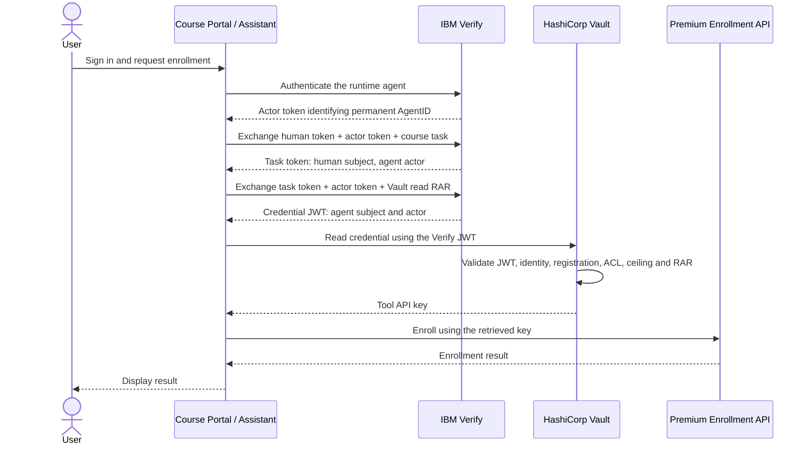

<!--
Copyright IBM Corp. All Rights Reserved.

SPDX-License-Identifier: Apache-2.0
-->

# IBM Verify + HashiCorp Vault — Secure Course Agent Tool Credentials

| ⚠️ General availability ⚠️ |
| :--- |
| This demonstration uses generally available IBM Verify Agent Identity capabilities. Availability may vary by data center and tenant rollout. Confirm that the required capabilities are enabled in your tenant before starting |

An end-to-end reference implementation for securing an AI agent’s tool credential using **IBM Agent Identity in IBM Verify** and **HashiCorp Vault native agent authorization**.

A Course Assistant acts on behalf of a signed-in user, obtains authorization for a course-enrollment task, and retrieves the required tool credential from Vault using its **permanent AgentID**.

## Objective

A human user signs in to a Course Portal and asks the **Course Assistant** to enroll in a course.

- Standard courses use the normal application path.
- Premium courses use a protected enrollment API that requires an API key.
- The API key is stored in Vault and retrieved at runtime. It is not embedded in application source code, browser content, or prompts.
- IBM Verify issues a human-context task token, followed by an agent-scoped credential-read token.
- Vault releases the API key only when the credential JWT, synchronized agent identity, Agent Registry registration, policies, and requested authorization details permit the read.
- The Course Assistant uses the retrieved key to invoke the protected enrollment API.

The application uses a dummy API key and an in-memory enrollment service for demonstration.

## Runtime authorization flow

The token roles are:

| Token | Subject (`sub`) | Immediate actor (`act.sub`) |
|---|---|---|
| Portal access token | Signed-in human | Not required |
| Runtime actor token | Permanent AgentID | Not required |
| Task token | Signed-in human | Permanent AgentID |
| Credential-read token | Permanent AgentID | Permanent AgentID |

The credential JWT retains generated `act`, including any nested actor history. Vault resolves its subject and immediate actor through the same agent alias. This flow does not require a separate Vault identity for each human.

## Agent onboarding and synchronization

Complete onboarding and synchronization before runtime credential access:

1. Onboard Course Assistant in IBM Verify and assign an owner.
2. Associate its runtime OAuth client, whose purpose is `agent_id`.
3. Activate the agent.
4. Synchronize its identity and lifecycle into Vault using Antenna or an adapter implementing the synchronization contract.

The required Vault state is:

| Object | Purpose |
|---|---|
| Identity entity named `verify-agent-<AgentID>` | Stable representation of the governed agent |
| OAuth alias bound to the Verify issuer and permanent AgentID | Resolve the agent identity carried in signed tokens |
| Entity ACL | Permit the specific credential read |
| Agent Registry registration | Register the entity as an agent and attach its authorization ceiling |

The alias uses the **permanent Verify AgentID**, rather than the runtime OAuth client ID. Replacing runtime credentials therefore does not require changing the Vault alias, provided the replacement client is properly associated, authorized, and configured to issue the same trusted AgentID.

## Start here

1. Read [START-HERE.md](START-HERE.md).
2. Follow [SETUP-GUIDE.md](SETUP-GUIDE.md) from the beginning. It includes prerequisites, commands, console configuration, expected results, and checkpoints.
3. Copy the repository-root [lab.env.example](lab.env.example) to `lab.env` and fill values as instructed.
4. Validate synchronization and the command-line JWT credential read before starting the portal.
5. Run the browser demonstration and record results in [docs/ACCEPTANCE-RESULTS.md](docs/ACCEPTANCE-RESULTS.md).

The same root `lab.env` supplies the setup helpers and Antenna configuration.

## Demonstration scenarios

| Course | Expected result |
|---|---|
| BAS-101 — Security Fundamentals | Standard enrollment succeeds without Vault |
| IAM-201 — Identity and Access Management Essentials | Standard enrollment succeeds without Vault |
| PREM-801 — Enterprise AI Agent Security | Enrollment requires Verify authorization and Vault credential retrieval |
| PREM-901 — Advanced Agent Governance | Denied by the lab’s configured course-task restriction |

The premium-course restriction is based on the allowed **course ID**, not a price threshold. The sample does not implement CIBA, payment processing, or human approval during enrollment.

## Compatibility requirements

Use a licensed Vault Enterprise environment that supports:

- OAuth Resource Server JWT validation.
- Agent Registry.
- Identity entities and issuer-bound aliases.
- KV v2 credential storage.

A PKI-only environment is unsuitable for this KV-based demonstration. Complete the compatibility checks in the setup guide before proceeding.

## Repository map

| Location | Contents |
|---|---|
| `START-HERE.md` | Entry point and fresh-start instructions |
| `SETUP-GUIDE.md` | Complete setup and validation procedure |
| `lab.env.example` | Template for local configuration |
| `docs/` | Numbered cookbook chapters and acceptance worksheet |
| `app/` | Course Portal and protected enrollment API |
| `config/` | Course catalogue |
| `verify/` | Authorization detail schemas and token helpers |
| `vault/` | Policies, OAuth configuration, bootstrap and validation helpers |
| `sync/antenna/` | Antenna synchronization implementation |
| `sync/custom-adapter/` | Synchronization contract for alternative integrations |
| `postman/` | API collection and environment template |
| `scripts/` | Workstation and application configuration helpers |

## Design principles

- Preserve the human subject in the task token.
- Use the permanent AgentID for Vault-facing credential authority.
- Use separate Task Exchange and Credential Exchange applications.
- Configure task-token validity to **3,600 seconds** and credential-token validity to **300 seconds**; verify actual issued lifetimes.
- Require the exact `vault:path_access` authorization details for credential retrieval.
- Enforce both the entity ACL and the registered agent’s authorization ceiling.
- Use administrator credentials for bootstrap, a restricted token for synchronization, and the Verify credential JWT for runtime reads.
- Treat Antenna as a reference integration; alternative adapters must produce the same identity and lifecycle outcomes.
- Validate suspension and reactivation after synchronization propagates. Suspension does not recall a static API key already released to a runtime.
