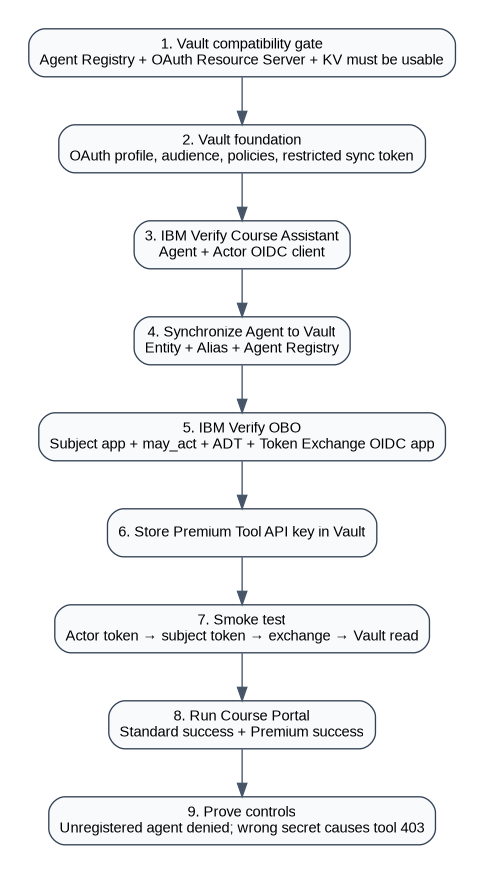

# Start Here — Read This Before Configuring Anything

This repository is written for a reader who has **no prior knowledge of the earlier demos**.

Do not jump directly to token exchange or the Course Portal. The cookbook deliberately builds the trust chain in the same order the runtime depends on it.

## The business use case in one minute

The Course Assistant can call a protected premium-enrollment tool. That tool expects an API key.

Instead of giving the API key permanently to the agent:

1. Store the API key in Vault.
2. Create the Course Assistant as an agent in IBM Verify.
3. Synchronize that same agent into Vault so Vault knows it is an approved agent and can apply an authorization ceiling.
4. The human signs in and receives a subject token.
5. The Course Assistant authenticates and receives an actor token.
6. IBM Verify exchanges the subject + actor tokens and a `vault:path_access` authorization detail for a delegated JWT.
7. The Course Assistant presents that JWT directly to Vault.
8. Vault validates the token, resolves identities, checks the actor's Agent Registry registration, evaluates subject policy + agent ceiling + RAR, and returns the API key only if all checks pass.
9. The agent calls the premium enrollment tool using the returned API key.

## The five concepts to remember

| Concept | Meaning in this cookbook |
|---|---|
| IBM Verify Agent | Governance record for the Course Assistant |
| Actor OIDC application | Runtime credential identity used to mint the actor token |
| Vault Identity entity + alias | How Vault resolves the JWT identity |
| Vault Agent Registry record | Marks that entity as an approved agent and applies an authorization ceiling |
| Delegated JWT | Runtime credential carrying human subject, actor context, audience, and `authorization_details` |

## Two credentials are intentionally separate

### Synchronization time

A trusted backend integration uses a **restricted Vault provisioning token** to create/update Vault identity and Agent Registry objects.

### Runtime

The Course Assistant **does not receive that provisioning token**. It uses the IBM Verify delegated JWT directly as `X-Vault-Token` to read the one permitted tool secret.

## Execute in this order

1. [Use case and expected outcomes](docs/01-USE-CASE-AND-OUTCOMES.md)
2. [Architecture and trust model](docs/02-ARCHITECTURE.md)
3. [Prerequisites and values worksheet](docs/03-PREREQUISITES.md)
4. [Vault compatibility gate](docs/04-VAULT-COMPATIBILITY-GATE.md)
5. [Prepare Vault foundation](docs/05-VAULT-FOUNDATION.md)
6. [Create Course Assistant in IBM Verify](docs/06-CREATE-COURSE-ASSISTANT.md)
7. [Synchronize the agent to Vault](docs/07-SYNC-AGENT-TO-VAULT.md)
8. [Validate the new Vault license and store the tool credential](docs/07A-STORE-TOOL-SECRET-BEFORE-VERIFY.md)
9. [Configure IBM Verify OBO and token exchange](docs/08-CONFIGURE-VERIFY-OBO.md)
10. [Reconfirm the Protected Tool API Key](docs/09-STORE-TOOL-SECRET.md)
11. [Smoke-test tokens and Vault before running the app](docs/10-SMOKE-TEST.md)
12. [Run the Course Portal](docs/11-RUN-DEMO.md)
13. [Run the negative/control tests](docs/12-NEGATIVE-TESTS.md)
14. [Troubleshooting](docs/13-TROUBLESHOOTING.md), including the [validated Mac/Antenna setup issues](docs/13A-VALIDATED-SETUP-TROUBLESHOOTING.md)
15. [Build your own synchronization adapter](docs/14-CUSTOM-SYNC-CONTRACT.md)
16. [Reference links](docs/15-REFERENCES.md)

## Capture your configuration as you go

The cookbook includes safe reference screenshots plus tenant-specific placeholders. Keep the filenames and replace each placeholder with your own screen capture after that step passes. Use [docs/SCREENSHOT-CHECKLIST.md](docs/SCREENSHOT-CHECKLIST.md). Never capture secrets or full tokens.

## Rule for every phase

Every phase ends with a **STOP CHECKPOINT**. Do not proceed until the checkpoint passes. This prevents a later Course Portal error from hiding an earlier identity or authorization configuration problem.
