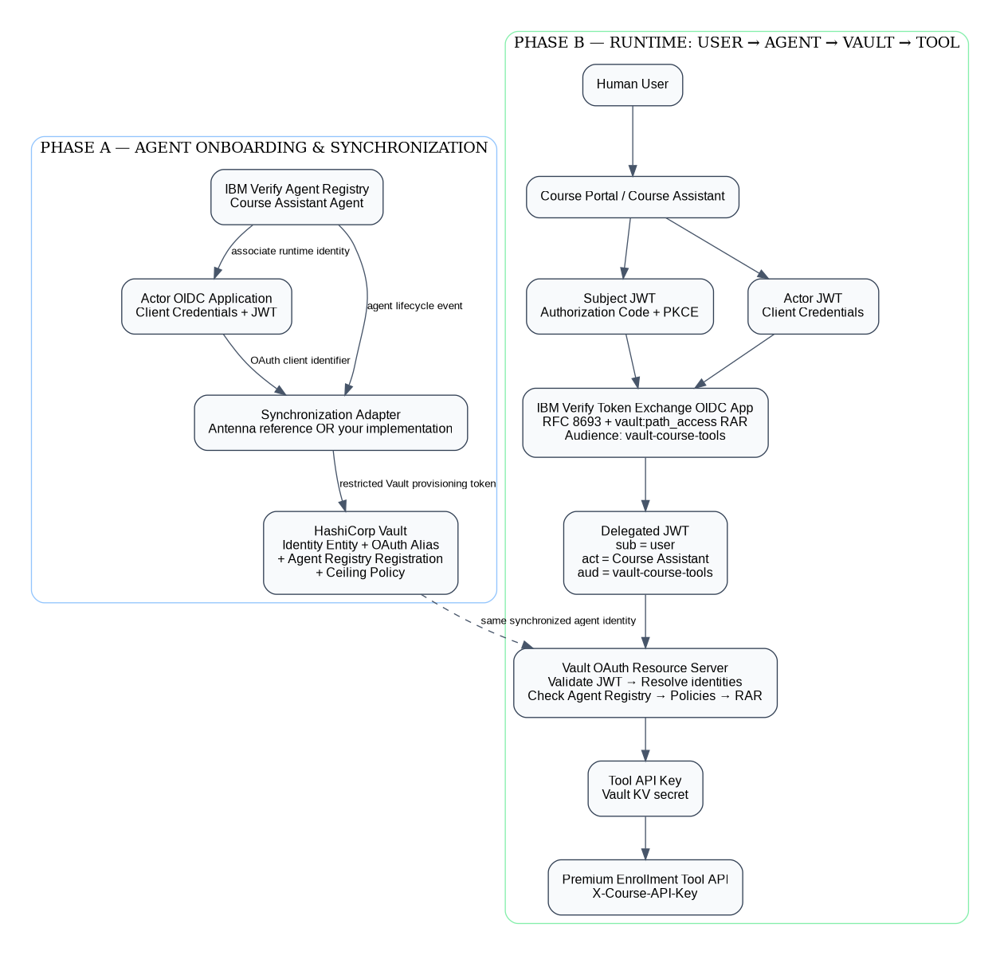
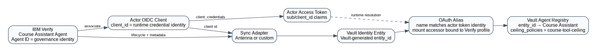
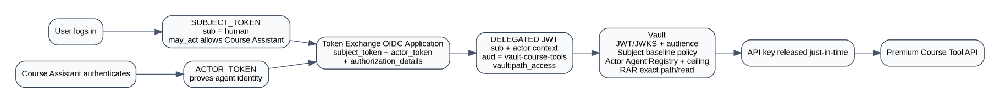
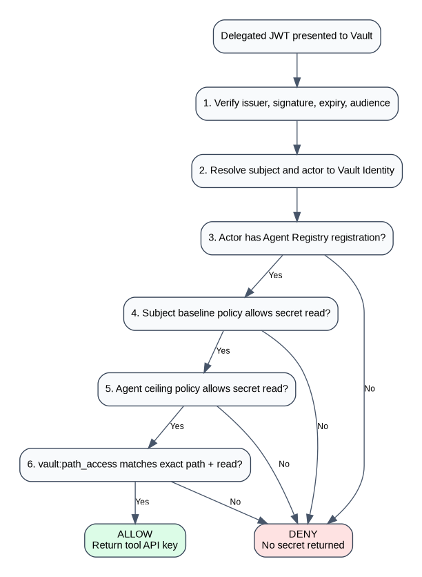

# 2. Architecture and Trust Model

## 2.1 End-to-end architecture



The solution has two connected phases.

### Phase A — Agent onboarding and synchronization

IBM Verify is the source registry for the Course Assistant and its associated runtime OAuth client. A synchronization adapter creates the corresponding Vault Identity entity, OAuth alias, and Agent Registry registration.

Antenna is included as a reference implementation. Customers can replace it with their own service as long as they implement the synchronization contract in [14-CUSTOM-SYNC-CONTRACT.md](14-CUSTOM-SYNC-CONTRACT.md).

### Phase B — Runtime authorization

The human and Course Assistant independently obtain tokens from IBM Verify. A Token Exchange OIDC application combines the subject token, actor token, and RAR authorization detail into a delegated JWT. Vault validates the delegated JWT and returns the protected tool API key only after all controls pass.

## 2.2 Identity mapping



The IDs have different purposes:

| Identifier | Purpose |
|---|---|
| IBM Verify Agent ID | Stable governance/lifecycle identity of the Course Assistant |
| Actor OIDC `client_id` | OAuth client associated with the agent |
| Actor token `sub` | Runtime identity value that Vault must be able to resolve through an alias |
| Vault Identity `entity_id` | Vault-generated canonical entity identifier |
| Vault Agent Registry `id` | Vault-generated registration identifier |

**Do not use the IBM Verify Agent ID as the Vault Agent Registry `entity_id`.** Vault Agent Registry expects the ID of an existing Vault Identity entity.

### Runtime alias rule

Before finalizing synchronization, decode one actor token and record its `sub` and `client_id`.

The OAuth alias created in Vault must match the identity Vault resolves from the actor JWT. In the reference implementation, the associated OAuth client ID is used as the alias and is expected to match the actor runtime identity. If your tenant maps a different actor `sub`, update the sync mapper accordingly.

## 2.3 Runtime token flow



### Subject token

Answers: **Who asked for the action?**

Created by the Course Portal OIDC application using Authorization Code + PKCE.

### Actor token

Answers: **Which agent is executing the action?**

Created by the Course Assistant Actor OIDC application using Client Credentials.

### `may_act`

Answers: **Is this actor allowed to act on behalf of this subject?**

The `may_act` object is mapped into the subject token/introspection context and must correlate with properties in the actor token.

### Delegated JWT

Created by the Token Exchange OIDC application. It should carry:

- `sub` for the human subject,
- actor context for the Course Assistant,
- `aud` including the Vault audience,
- `authorization_details` containing `vault:path_access`.

## 2.4 Vault authorization decision



For the premium secret read, the request succeeds only when all of the following are true:

1. JWT issuer/signature/time/audience checks pass.
2. Subject and actor can be resolved to Vault Identity.
3. The actor has an Agent Registry registration.
4. Subject baseline policy allows the operation.
5. Actor ceiling policy allows the operation.
6. `vault:path_access` matches the exact path and `read` capability.

RAR can restrict access; it cannot grant permissions that Vault ACL policy does not already allow.

## 2.5 Trust boundaries

| Component | Trust role | Credential used |
|---|---|---|
| Browser / Course Portal | User-facing application | Subject session/token |
| Course Assistant runtime | Executes the premium tool | Actor token + delegated JWT |
| IBM Verify | Authenticates subject/actor and performs token exchange | OAuth client credentials / user session |
| Sync adapter | Provisioning integration | Restricted Vault synchronization token |
| Vault | OAuth resource server, agent governance, secret store | Delegated JWT at runtime |
| Premium Tool API | Downstream protected API | API key returned from Vault |

### Critical separation

```text
SYNC: restricted Vault provisioning token → create/update Vault objects
RUNTIME: IBM Verify delegated JWT          → read one authorized secret
```

The Course Assistant must never receive the Vault root token or synchronization token.
