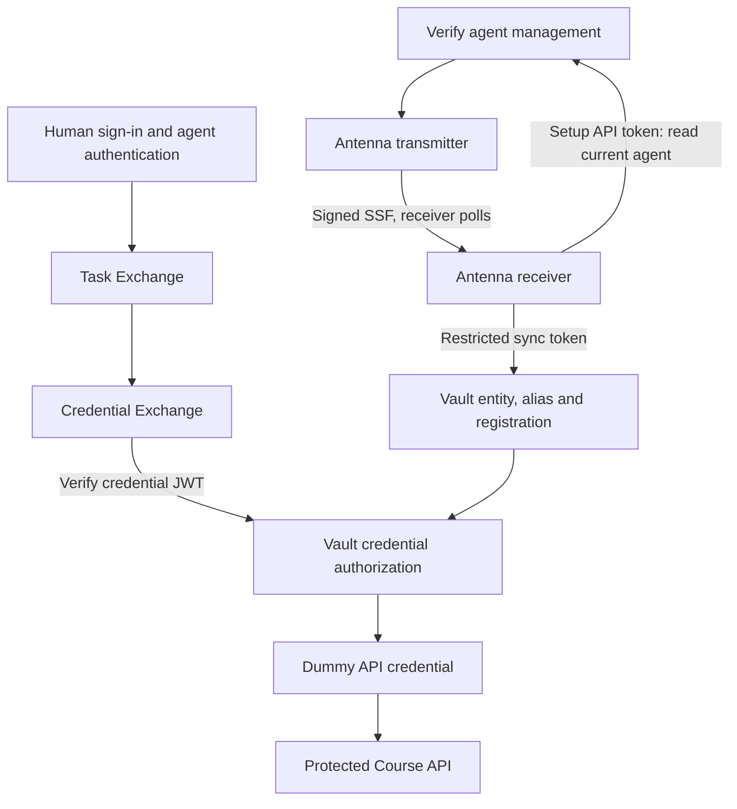

<!--
Copyright IBM Corp. All Rights Reserved.

SPDX-License-Identifier: Apache-2.0
-->

# Architecture and authorization boundaries

| Boundary | Required identity or permission |
|---|---|
| Runtime actor | Permanent AgentID in signed `sub`; runtime client ID retained |
| Task authority | Human `sub`, agent `act.sub`, approved course task RAR |
| Credential authority | AgentID in `sub` and immediate `act.sub`; exact Vault read RAR |
| Vault identity | One issuer-bound AgentID alias on the synchronized entity |
| Vault subject permissions | `course-tool-subject` ACL |
| Vault actor permissions | Agent Registry registration with `course-tool-ceiling` |

All Vault operations target the root namespace. Administrator setup uses the root token, synchronization uses a restricted provisioning token and runtime reads use the Verify credential JWT. The common API/ACL/RAR path is `course-tools/data/premium-enrollment`.
