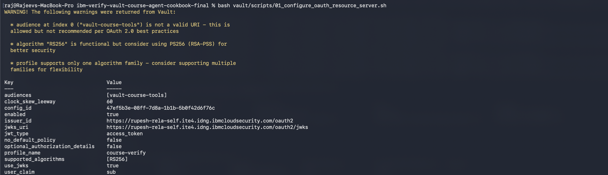

# 5. Prepare the Vault Foundation

Complete this phase before synchronizing the Course Assistant.

## What this phase creates

- OAuth Resource Server trust profile for IBM Verify.
- Audience validation (`vault-course-tools`).
- Subject baseline policy.
- Agent ceiling policy.
- Restricted Vault synchronization policy/token.
- OAuth profile `config_id` and mount accessor used by identity aliases.

## Prerequisite

- [04-VAULT-COMPATIBILITY-GATE.md](04-VAULT-COMPATIBILITY-GATE.md) passed.
- You know your IBM Verify issuer URL.

## Step 5.1 — Activate OAuth Resource Server support

```bash
vault write -f sys/activation-flags/oauth-resource-server/activate
```

## Step 5.2 — Create the OAuth Resource Server profile

Edit:

```text
vault/config/course-verify-oauth-profile.json.template
```

Replace:

```text
__VERIFY_ISSUER__
__VERIFY_JWKS_URI__
__VAULT_AUDIENCE__
```

Recommended audience:

```text
vault-course-tools
```

Then run:

```bash
bash vault/scripts/01_configure_oauth_resource_server.sh
```

The profile uses:

```json
{
  "issuer_id": "https://<your-tenant>/oauth2",
  "use_jwks": true,
  "jwks_uri": "https://<your-tenant>/oauth2/jwks",
  "audiences": ["vault-course-tools"],
  "user_claim": "sub",
  "supported_algorithms": ["RS256"],
  "jwt_type": "access_token",
  "optional_authorization_details": false,
  "enabled": true
}
```

`optional_authorization_details=false` keeps RAR required.

### Screenshot




A reference from the supplied setup material is available under `images/screenshots/reference/`.

## Step 5.3 — Record `config_id` and alias mount accessor

Run:

```bash
bash vault/scripts/02_get_oauth_profile_binding.sh
```

Record:

```text
VAULT_OAUTH_CONFIG_ID
VAULT_OAUTH_MOUNT_ACCESSOR
```

The included script follows the tested profile-binding pattern used by the supplied IBM Verify/Vault reference setup and writes the values to `vault/.oauth-runtime.env`.

## Step 5.4 — Create the policies

### Subject baseline policy

`vault/policies/course-tool-subject.hcl`

```hcl
path "course-tools/data/premium-enrollment" {
  capabilities = ["read"]
}
```

### Agent ceiling policy

`vault/policies/course-tool-ceiling.hcl`

```hcl
path "course-tools/data/premium-enrollment" {
  capabilities = ["read"]
}
```

Run:

```bash
bash vault/scripts/03_write_runtime_policies.sh
```

## Step 5.5 — Create a restricted synchronization token

The synchronization adapter needs provisioning access, but it should not use the root token after bootstrap.

Run:

```bash
bash vault/scripts/04_create_sync_token.sh
```

Store the returned token securely as:

```text
VAULT_SYNC_TOKEN
```

The synchronization policy is intentionally separate from runtime secret access.

### Security boundary

```text
Vault admin/root token       → bootstrap only
Restricted VAULT_SYNC_TOKEN → synchronization only
Delegated IBM Verify JWT    → runtime secret read only
```

## STOP CHECKPOINT

Before continuing:

```text
[ ] OAuth Resource Server activated
[ ] course-verify profile exists and is enabled
[ ] audience = vault-course-tools
[ ] optional_authorization_details = false
[ ] config_id recorded
[ ] mount accessor recorded
[ ] course-tool-subject policy exists
[ ] course-tool-ceiling policy exists
[ ] restricted synchronization token created
```
